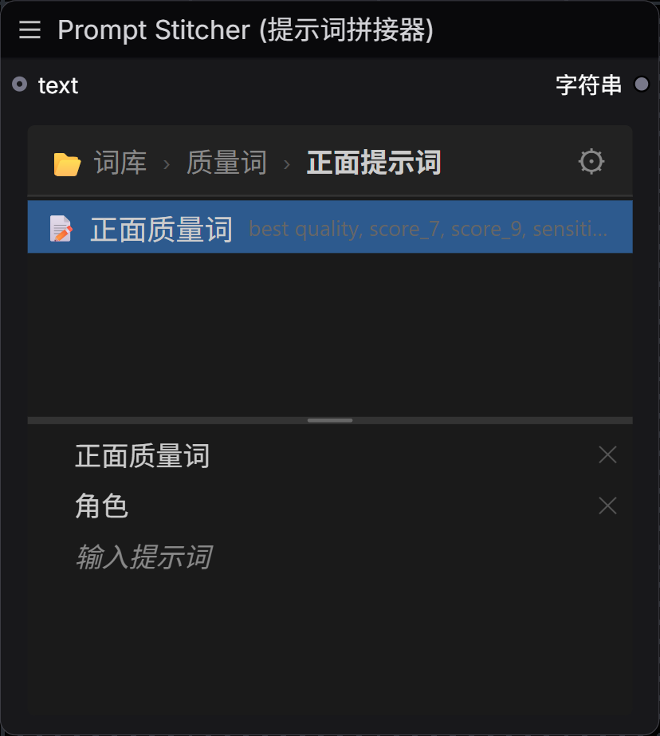
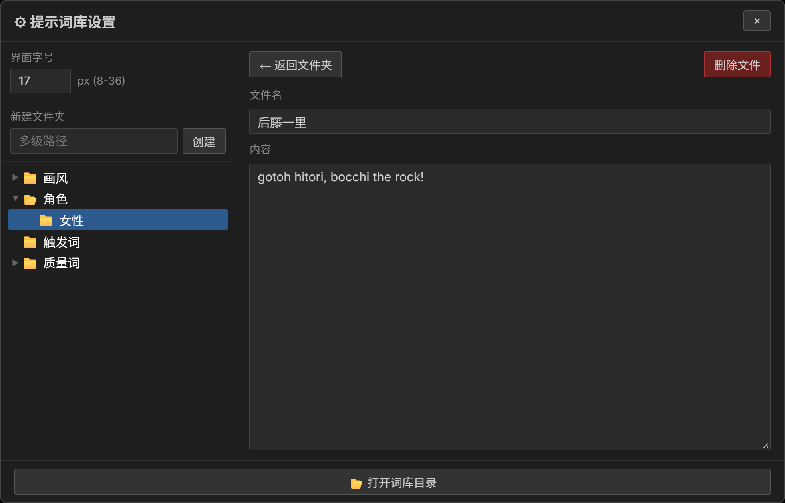

# ComfyUI Prompt Stitcher（提示词拼接器）

一个 ComfyUI 自定义节点：把本地词库里的提示词片段和外部输入的 STRING 拼接成一条干净的提示词，并提供一个可在节点内直接管理的词库面板。



## 功能

- **词库浏览**：节点内面包屑导航，多级文件夹，点击 `.txt` 即可加入/移出拼接列表
- **前后缀拼接**：`输入提示词` 之前的片段作为前缀，之后的作为后缀，用 `, ` 连接
- **顺序可调**：已选列表支持拖拽排序，同文件夹的新条目自动追加到该组末尾
- **自动清洗**：合并连续逗号、去掉首尾逗号
- **词库管理**：节点内设置面板可调字号（8–36px）、新建/重命名/删除文件夹、编辑文件内容、打开词库目录
- **状态持久化**：选择项、排序、当前路径、分割线比例随工作流保存
- **多实例**：同一工作流可放多个节点，各自独立
- **自适应布局**：面板始终填满节点，兼容 ComfyUI 的 Vue 节点模式与经典画布模式

## 安装

```bash
cd ComfyUI/custom_nodes
git clone <本仓库地址> ComfyUI-PromptStitcher
```

重启 ComfyUI，然后 **Ctrl+Shift+R** 强制刷新浏览器缓存。

节点位置：`Prompt / Prompt Stitcher (提示词拼接器)`。

无需额外 Python 依赖（使用 ComfyUI 自带的 aiohttp）。

## 使用

1. 把提示词按文件夹放进 `ComfyUI-PromptStitcher/prompt_library/`，一个 `.txt` 文件就是一条提示词：
   - 文件名 = 列表里显示的名称
   - 文件内容 = 实际参与拼接的文本
2. 在节点里点击文件夹进入下一级，点击文件选中（再点取消）
3. 在下方列表拖动调整顺序；`输入提示词` 是外部 STRING 的插入位置
4. 把上游文本节点接到 `text` 输入，节点输出的 STRING 就是拼接结果

示例结构：

```
prompt_library/
├── 画风/
│   └── 1.txt
├── 角色/
│   ├── 女性/
│   │   └── 角色名.txt
│   └── 男性/
│       └── 角色名.txt
└── 质量词/
    ├── 正面提示词/
    │   └── 正面质量词.txt
    └── 负面提示词/
        └── 负面质量词.txt
```

### 设置面板

点击节点右上角的 ⚙：



- **界面字号**：8–36px，保存在 `prompt_library/settings.json`
- **新建文件夹**：支持 `质量词\正面提示词` 形式一次创建多级
- **左侧文件夹树**：展开/折叠、重命名、删除
- **右侧编辑区**：浏览文件夹内容，点文件即可改文件名和内容（300ms 防抖自动保存）
- **打开词库目录**：调用系统文件管理器

面板尺寸为视口的 70%，四周各留 15%；内部全部使用相对字号，大字号下会自动换行、滚动，不会溢出。

## 节点输入输出

| 类型 | 名称 | 说明 |
| --- | --- | --- |
| 可选输入 | `text` | 外部 STRING，插入到列表里 `输入提示词` 的位置 |
| 隐藏输入 | `state_json` | 面板状态的序列化载体，节点上不显示 |
| 输出 | `STRING` | 拼接并清洗后的提示词 |

拼接顺序：`前缀片段, text, 后缀片段`。

## 文件结构

```
ComfyUI-PromptStitcher/
├── __init__.py                  # 节点与 API 注册入口
├── nodes/prompt_stitcher.py     # 节点定义与拼接逻辑
├── api/prompt_library_routes.py # 词库读写 HTTP 接口（/prompt-stitcher/*）
├── web/js/prompt_stitcher.js    # 前端面板（样式 + 交互 + 设置弹窗）
├── docs/                        # README 截图
└── prompt_library/              # 用户词库；settings.json 也存在这里（均不纳入版本管理）
```

## 兼容性

在 ComfyUI 0.41.3、前端 1.55.17 上验证（Vue 节点模式与经典画布模式均可用）。依赖前端的 `addDOMWidget` API，ComfyUI 版本过旧时面板不会显示。

## 本地数据

所有用户数据都在插件目录内，不放在 ComfyUI 的 `user/` 下：

| 内容 | 路径 |
| --- | --- |
| 词库（文件夹 + `.txt`） | `ComfyUI/custom_nodes/ComfyUI-PromptStitcher/prompt_library/` |
| 界面字号设置 | `ComfyUI/custom_nodes/ComfyUI-PromptStitcher/prompt_library/settings.json` |

秋叶整合包的实际位置是 `D:\ComfyUI-aki-v2\ComfyUI\custom_nodes\ComfyUI-PromptStitcher\prompt_library\`。

这两个路径都已写进 `.gitignore`，`git pull` 不会覆盖本地词库；重装或迁移插件前，备份整个 `prompt_library/` 即可。

## License

本项目以 **GNU General Public License v3.0** 发布，详见 [LICENSE](LICENSE)。

Copyright (C) 2026 cyzfigd
